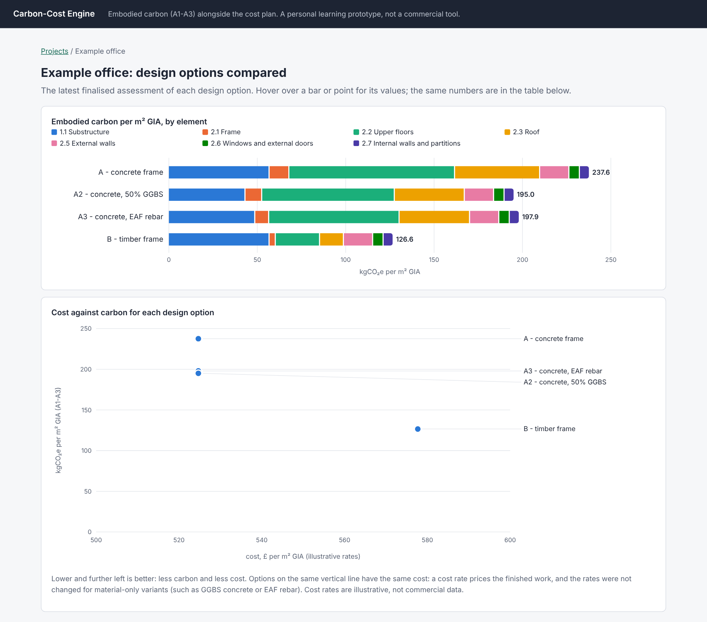
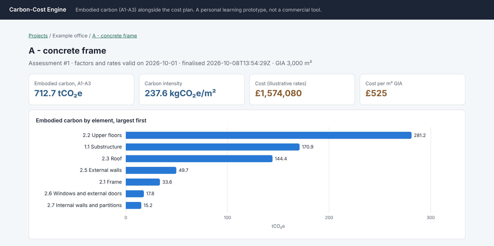

# Carbon-Cost Engine

**Embodied carbon alongside the cost plan.** One list of quantities, laid
out like a quantity surveyor's cost plan, gives both a cost and an embodied
carbon figure, so design options can be compared on both before decisions
are fixed.

A personal learning project by Yarushah Emmanuel Sardar. It is an
independent prototype, not a commercial tool, and not affiliated with any
company.



## What it found

For an illustrative 3,000 m2 office (product stage A1-A3, structure and
envelope; full write-up in [`docs/writeup.md`](docs/writeup.md)):

| Design option | kgCO2e/m2 | vs concrete | Cost/m2 (illustrative) |
|---|---:|---:|---:|
| A - concrete flat slab | 238 | | £525 |
| A + 50% GGBS + EAF-route rebar | 155 | -35% | £525 |
| B - glulam frame, CLT floors | 127 | -47% | £578 |
| B + GGBS and EAF rebar in the foundations | 105 | -56% | £578 |

- Slabs and foundations are 83% of the concrete option's embodied carbon.
- Two specification choices, with no design change, deliver about three
  quarters of the saving of a change to timber.
- Which rebar factor is used moves the result by 17%: data choices need
  recording as carefully as design choices.

## What it does

- **Loads carbon factors** from the ICE Database (a report-style
  spreadsheet with 64 tables in 14 layouts). Every row is loaded or rejected
  with a reason (502 loaded, 228 rejected), and nothing is guessed.
- **Imports a project** from CSV files laid out like a cost plan (NRM1
  elements, items, and the materials inside each item). Everything is
  checked first, and every problem is listed at once.
- **Calculates** carbon per material and cost per item with the factors and
  rates valid on a chosen date, and **saves each run as a permanent record**
  of the exact rows it used. Any past result can be reproduced.
- **Shows** cost and carbon side by side by element, compares options, runs
  what-if material swaps without saving, draws charts, and exports a flat
  CSV for **Power BI**.



## Design decisions worth knowing

- **Nothing is overwritten.** Carbon factors and cost rates are replaced
  with a new dated row and never edited or deleted. Database triggers refuse
  any assessment line that cites the wrong material's factor, a factor not
  valid on the assessment date, or a carbon figure that is not quantity x
  factor. ([design note](docs/design_note.md), section 4)
- **Nothing is converted to fit.** A per-m2 factor is never turned into a
  per-kg one; a volume only becomes a mass with a cited density.
- **Biogenic carbon is reported, never subtracted**, because the end-of-life
  release is not modelled.
- **One item, several materials.** A slab is concrete plus the rebar inside
  it, linked explicitly so the rebar uses the right volume.
- **Data governance built in.** Each source records its licence and whether
  it may be redistributed; that flag travels into every export row.

## Run it

Needs Python 3.9 or newer with SQLite 3.37 or newer (the code checks and
says so if it is older). Tested on Python 3.9 and 3.10.

```
python3 -m venv .venv
source .venv/bin/activate                # Windows: .venv\Scripts\activate
python -m pip install --upgrade pip      # the pip that comes with macOS Python 3.9 is too old
python -m pip install -e ".[dev]"
python -m pytest                          # 194 tests; they need no ICE data
```

Then get the carbon data and build the database:

1. Download **ICE Database Educational V5.0** from
   <https://circularecology.com/embodied-carbon-footprint-database.html>
   and save it as `data/raw/ICE_DB_Educational_V5.0_-_Jun_2026.xlsx`.
2. Load everything and run the example:

   ```
   python -m carbon_cost.ingest.ice           # carbon factors (prints what was loaded and rejected)
   python -m carbon_cost.ingest.densities     # confirmed densities
   python -m carbon_cost.ingest.project       # illustrative cost rates + the example office
   python -m carbon_cost.engine --as-of 2026-10-01
   python -m carbon_cost.app                  # then open http://127.0.0.1:5000
   ```

3. Optional:

   ```
   python -m carbon_cost.sensitivity          # the sensitivity table in the write-up
   python -m carbon_cost.export               # CSV for Power BI, written to exports/
   ```

The ingestion writes `data/staging/` files (the raw sheet, every accepted
factor, every rejected row with its reason) so each decision can be checked
by eye.

## Project layout

| Path | What it is |
|---|---|
| `carbon_cost/schema.sql` | The database, including the rules it enforces itself (triggers) |
| `carbon_cost/db.py` | Connections (foreign keys always on), transactions, superseding a factor or rate |
| `carbon_cost/ingest/ice.py` | Parses the ICE summary sheet |
| `carbon_cost/ingest/densities.py` | Loads the densities a person has confirmed |
| `carbon_cost/ingest/project.py` | Cost rates and CSV project import, with full validation |
| `carbon_cost/engine.py` | Calculation, saved assessments, comparison, what-if swaps, reproduction |
| `carbon_cost/sensitivity.py` | Single-change scenarios on a temporary copy of the database |
| `carbon_cost/charts.py` | SVG charts drawn on the server; colour-vision-checked palette |
| `carbon_cost/export.py` | Flat CSV export for Power BI |
| `carbon_cost/app/` | Web interface (Flask) |
| `data/reference/` | Hand-written inputs: densities (with sources), cost rates, material aliases, the example project |
| `docs/` | Design note, ER diagram, example assumptions, write-up, screenshots |
| `tests/` | 194 automated tests, using made-up data only |

## Data sources and licence

| Data | Source | In this repository? |
|---|---|---|
| Embodied carbon factors (A1-A3) | ICE Database Educational V5.0 (June 2026), Circular Ecology Ltd | **No.** Educational use only; may not be redistributed in whole or in part. Download your own copy. |
| Densities | BS EN 1991-1-1, BS EN 14080 and manufacturers' data sheets, cited row by row in `data/reference/densities.csv` | Yes |
| Cost rates | Illustrative, written for this prototype; not commercial data | Yes |
| Element structure | RICS NRM1 (names and codes) | Yes |

Credit: **ICE Database Educational V5.0, Circular Ecology Ltd**,
<https://circularecology.com/embodied-carbon-footprint-database.html>.
On 1 October 2026 the download page listed V5.0 as the latest version (a
cell in the file that says "this version has expired" is a date formula).
Every ICE factor is given `valid_from = 2026-06-01`, its release month; an
assessment dated earlier stops with an error rather than using another
factor.

Nothing derived from ICE is committed: `data/raw/`, `data/staging/`, `db/`
and `exports/` are git-ignored, and the tests use made-up numbers.

## Limitations

- Product stage (A1-A3) only, for structure, envelope and partitions. No
  transport, construction, use or end of life; no services or finishes.
  Not comparable with whole-life benchmarks.
- Generic factors, not product-specific EPDs. No wastage allowance.
- Illustrative quantities and cost rates. Cost does not respond to a
  material swap unless the item's rate is changed.
- The ICE file leaves 21 mortar, screed and admixture rows without a stated
  unit; they are excluded. One concrete row with a contradictory label is
  excluded. "A Single Brick" is stored per brick, as its ICE name states.
- Densities are not versioned (each run stores the density it used).
- Python, SQLite and a local web server: a single-user prototype.

## Licence

The code is MIT-licensed (see `LICENSE`). That licence covers this
repository only, not the ICE Database, which has its own terms.
