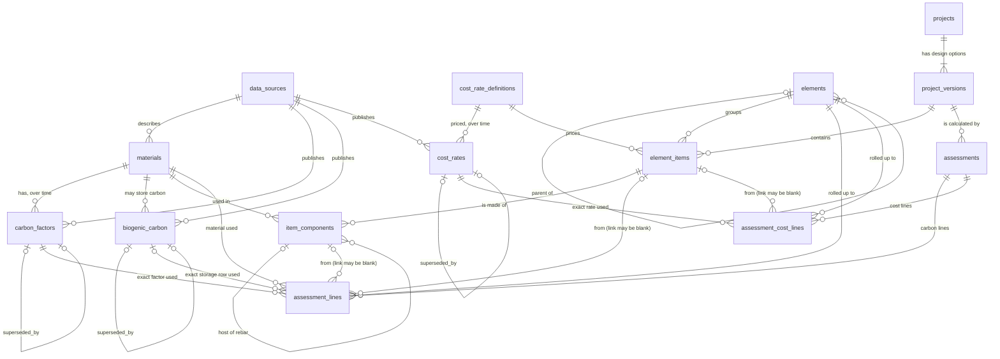

# Design note: the database

This note explains the database behind the carbon-cost engine: what each
table is for and why it is built the way it is. It is written so that
someone who has never designed a database can follow it.

The schema itself is in [`carbon_cost/schema.sql`](../carbon_cost/schema.sql). The rules
described here are checked by the tests in `tests/test_schema.py`.

---

## 1. What problem is the database solving?

A cost plan says what a building will **cost**. An embodied carbon
assessment says how much **carbon** is released making its materials.
Both start from the same thing: a list of quantities (so many m2 of
floor slab, so many m3 of foundation).

The database stores that one list of quantities and attaches two sets of
numbers to it:

- **cost rates**, in pounds per m2, m3 or item, and
- **carbon factors**, in kg of CO2e per kg, m2 or unit of material.

So one quantity gives both a cost and a carbon figure, and a designer can
see both when choosing between options.

### A few words used in this note

| Word | Meaning |
|---|---|
| **Embodied carbon** | Greenhouse gas released to make and supply a material, measured in kg of CO2 equivalent (kgCO2e). |
| **Carbon factor** | How much carbon one unit of a material causes, e.g. kgCO2e per kg of concrete. |
| **Lifecycle module** | A stage in a building's life. **A1-A3** = making the product (raw material, transport to factory, manufacture). A4-A5 = getting it to site and building. B = use. C = end of life. D = benefits after end of life. This project only has data for A1-A3. |
| **Biogenic carbon** | Carbon a tree took out of the air while growing, which stays locked in timber. |
| **NRM1** | The RICS standard way to split a building into elements (1 Substructure, 2.1 Frame, 2.2 Upper floors ...). Cost plans are laid out this way. |
| **GIA** | Gross internal area, in m2. Used to give results per m2 so buildings of different sizes can be compared. |
| **Foreign key** | A database rule: "this column must point at a row that really exists in another table". |
| **Trigger** | A small rule the database runs by itself whenever a row is added, changed or removed. |

---

## 2. The whole picture

How to read a line: `materials ||--o{ carbon_factors` means "one material
has zero or more carbon factors". The full diagram with every column is in
[`er_diagram.mmd`](er_diagram.mmd) (picture: [`er_diagram.png`](er_diagram.png)).

The tables fall into four groups:

| Group | Tables | In one sentence |
|---|---|---|
| **Reference data** | `data_sources`, `materials`, `carbon_factors`, `biogenic_carbon`, `cost_rate_definitions`, `cost_rates`, `benchmarks` | The numbers we look up. |
| **Structure** | `elements` | The NRM1 tree that results are grouped by. |
| **The project** | `projects`, `project_versions`, `element_items`, `item_components` | What is being built, and how much of it. |
| **The record** | `assessments`, `assessment_lines`, `assessment_cost_lines` | What was calculated, when, and from which numbers. |

---

## 3. Why each table exists

### `data_sources`
Every factor and every rate must say where it came from. This table holds
the source once (name, publisher, version, licence, the credit line to
show, and a link) so each number only needs to point at it.

The `redistributable` flag (yes/no) records whether the data may be shared.
For the ICE Database it is **no**: ICE is licensed for educational use and
must not be passed on. Keeping this in the data means the app can check it
before showing or exporting anything.

### `materials`
One row per material: its full name, its category, and the path of
headings it sat under in the source. The path matters because a row called
"32/40 MPa" means nothing alone; "Concrete > In-Situ > By Strength Class >
With CEM I > 32/40 MPa" does. `name_in_source` keeps the source's exact
wording so any row can be traced back.

It also holds two physical facts the calculation needs:

- `density_kg_m3` (kg in one m3), to turn a volume into a mass. A density
  can only be saved together with `density_source`, because the densities
  in this project are checked by hand and a number without a source cannot
  be checked.
- `mass_per_item_kg`, the mass of one declared unit (for example one item,
  or one m2 of a wall that the source describes per m2).

Both are optional. A material with no density is still valid; the engine
simply refuses to use it where a density is needed.

### `carbon_factors`
The carbon number for a material: the value, its unit, the lifecycle
module, the source, a data quality score (DQI) and comments.

Three units are allowed: `kgCO2e/kg`, `kgCO2e/m2` and `kgCO2e/unit`. They
are kept as the source gives them. A per-m2 factor is **not** converted to
per-kg, because the source does not always give the information to do that
honestly. For per-unit factors, `declared_unit` records what one "unit" is
in the source's own words.

Only A1-A3 is filled in today, but the table accepts every module from
A1-A3 to D, so later stages can be added without changing the design.

Values must be zero or more (only module D may be negative). This stops a
"timber including carbon storage" figure, which is negative, from being
loaded as an ordinary factor by mistake.

This table is **versioned**; see section 4.1.

### `biogenic_carbon`
The carbon stored in timber, in kgCO2e per kg, with its source. It is
stored as a negative number, the same way the source reports it (negative
= taken out of the air). See section 4.4 for why it has its own table.

### `cost_rate_definitions` and `cost_rates`
A **definition** says *what* is priced and *in what unit*, for example
"Upper floor slab, 250mm reinforced concrete, per m2". It has a short code
(`ref`) that a quantity surveyor types into the project spreadsheet.

A **cost rate** is the price for that definition during a period. It is
versioned exactly like a carbon factor.

Two things are deliberate:

1. Rates price **building work** (a m2 of finished slab), not a kg of
   material. That is how cost plans are really priced: the rate includes
   labour, formwork, plant and so on.
2. Cost and carbon are kept in **separate tables**. They come from
   different sources, change at different times, and are attached at
   different levels (cost to the item, carbon to each material in it).

Every rate has an `is_illustrative` flag. All rates in this project are
illustrative, not commercial data, and the flag lets the app say so on
screen.

### `elements`
The NRM1 hierarchy as a tree: each element has a code, a name and a
parent. "2.2 Upper floors" has the parent "2 Superstructure". Storing the
parent lets results be added up level by level to a project total.

### `projects` and `project_versions`
A project is one building. A project version is one **design option** for
it, for example "concrete frame" and "timber frame". Each version has its
own list of items, so two options can be compared.

GIA is stored on the **version**, not the project, because a design option
can change the floor area.

A version is never deleted by the app. It has an `archived` flag instead:
an archived version is hidden on screen but kept, so every assessment
made from it still has something to point at.

### `element_items`
One measured quantity: a description, a number, a unit (m2, m3 or nr), the
NRM1 element it belongs to, and the cost rate that prices it. Example:
"Upper floor slab, 250mm RC, 2000 m2, element 2.2".

The database checks that the item's unit is the same as its cost rate's
unit, so a rate per m2 can never be multiplied by a quantity in m3.

### `item_components`
The materials inside an item. See section 4.3.

### `assessments`, `assessment_lines`, `assessment_cost_lines`
The saved result of one calculation run. See section 4.2.

### `benchmarks`
Published targets in kgCO2e per m2, with the building type, the lifecycle
scope they cover, the source and the year. The scope is stored because a
benchmark for the whole life of a building cannot be fairly compared with
an A1-A3 result for a few elements; the app has to be able to say so.

---

## 4. The four key ideas

### 4.1 Versioning: a number is replaced, never changed

**The problem.** Carbon data is updated. If a factor were simply
overwritten, every old result would silently stop matching the data it
came from, and nobody could explain a figure in last year's report.

**The rule.** A factor is never edited and never deleted. Each row has:

- `valid_from`: the first day it applies,
- `valid_to`: the first day it no longer applies (empty = still current),
- `superseded_by`: which row replaced it.

To change a factor you close the old row and add a new one.

Example (made-up numbers):

| id | material | value | valid_from | valid_to | superseded_by |
|---|---|---|---|---|---|
| 1 | Test concrete | 0.10 | 2020-01-01 | 2024-01-01 | 2 |
| 2 | Test concrete | 0.08 | 2024-01-01 | *(empty)* | *(empty)* |

Ask "which factor applied on 31 Dec 2023?" and the answer is row 1. Ask
for 1 Jan 2024 and it is row 2. Nothing was lost.

**What the database enforces by itself** (so a bug in the Python code
cannot break it):

- deleting a factor is refused;
- changing a factor's value, unit, material, module or start date is refused;
- `valid_to` and `superseded_by` can each be set once and never changed;
- the replacing row must be for the same material and module;
- two rows for the same material and module can never cover the same day,
  so "the factor valid on date X" always has exactly one answer.

`cost_rates` and `biogenic_carbon` follow the same rules.

**One function does the replacing.** Replacing a row takes three steps:
close the old row, add the new row, link the old row to the new one. If
only some of them happened, a material could be left with no current
factor. So the three steps are only ever run through one function for each
table (`supersede_carbon_factor`, `supersede_cost_rate` and
`supersede_biogenic_carbon` in `carbon_cost/db.py`), which runs them as a single
transaction: all three happen, or none. The test
`test_failed_supersede_changes_nothing` makes step two fail on purpose and
checks that step one was undone.

**A limit to know about.** There is one current factor per material per
module. Two sources for the "same" material at the same time are not
allowed. If two sources are needed (say, a generic figure and a
manufacturer's figure) they are entered as two materials with different
names. This keeps the answer to "which factor?" unambiguous.

### 4.2 Assessments: a result remembers exactly what it was made from

**The problem.** A result such as "X tonnes of CO2e" is only trustworthy if you
can show the working. And once factors change, re-running the calculation
gives a different answer, which is correct for today but does not explain
the old report.

**The design.** Each run of the calculation saves:

- one row in `assessments`: which project version, the "as of" date (which
  day's factors and rates to use), when it was run, and the GIA at the time;
- one row in `assessment_lines` for each material in each item, holding
  the **id of the exact `carbon_factors` row used**, plus the inputs
  (quantity, basis, volume, density, mass) and the carbon result;
- one row in `assessment_cost_lines` for each item, holding the **id of
  the exact `cost_rates` row used**, the quantity and the cost.

Because factor rows are never edited or deleted (4.1), that id will always
lead to the same number. So an old assessment can be recalculated from its
own stored lines and must give the same result. The test
`test_finalised_assessment_still_gives_the_same_answer_after_supersede`
shows this at database level.

**The database checks every line as it is written.** Storing a factor id
proves nothing if the id could be the wrong one. So a line is refused
unless all of these are true:

| Check | What it stops |
|---|---|
| the factor belongs to the line's material and lifecycle module | citing the rebar factor on a concrete line |
| the line's unit is the factor's unit | treating a per-m2 factor as per-kg |
| the factor was valid on the assessment's as-of date | using a factor that had not started yet, or one already replaced |
| carbon = quantity x factor value (to 1 part in 1,000,000,000) | a stored result that does not follow from its inputs |
| a per-kg line has a mass, and the mass is the quantity multiplied | mass and quantity drifting apart |
| the basis suits the unit (see 4.3) | for example a thickness with a per-m2 factor |
| if storage is recorded: same material, valid on the as-of date, a mass exists, and storage = mass x storage value | wrong or invented biogenic figures |

Cost lines get the same treatment: the rate must have been valid on the
as-of date, its unit must be the item's unit, and cost = quantity x rate.

The tolerance of one part in a billion is there only because computers
store decimals with tiny rounding in the last digits. It is far too small
to hide a real difference.

**Draft, then final.** An assessment has a `finalised_at` time, which
starts empty.

1. The assessment row is created as a **draft**.
2. All its lines are written.
3. `finalised_at` is set. The engine does steps 1 to 3 in one transaction.

After step 3 the database refuses any new line, any change and any
deletion for that assessment, for ever. `finalised_at` can be set once and
never altered. An assessment with no lines cannot be finalised.

A draft is different: it can be deleted, and its lines go with it. This
exists for one case, a run that fails halfway, so that a half-written
result never sits in the database looking like a real one. A result that
was finalised and later found to be wrong is not erased; a new assessment
is run.

The project version, the as-of date and the GIA of an assessment are fixed
from the moment the row is created, even while it is a draft. The lines
were checked against that as-of date, so changing it afterwards would make
those checks meaningless.

**Why the lines copy the inputs too.** Project items can be edited or
removed later, and a density can be corrected. If the lines only pointed at
the live project rows, an old result would change with them. So each line
keeps its own copy of the description, quantity, basis, density and mass.
The links back to the live item rows are kept while those rows exist and
are blanked automatically if they are deleted; the copies stay.

**Why two line tables.** Carbon is worked out per material (concrete and
rebar separately). Cost is worked out per item (one rate for the finished
slab). Putting both on one row would mean either repeating the cost on
every material line (and double counting it when adding up) or inventing a
split of the cost between materials that the data does not support.

### 4.3 Multi-component items: one item, several materials

**The problem.** A quantity surveyor measures "upper floor slab, 2000 m2".
But a reinforced concrete slab is two materials, concrete and steel
reinforcement (rebar), with very different carbon factors. A wall may be
four or five layers. One material per item would not describe a real
building.

**The design.** An item has one or more **components**. Each component
names a material and says how to get from the item's quantity to an amount
of that material. This is the `basis`:

| basis | Used when | Amount of material |
|---|---|---|
| `thickness_m` | item in m2, material has a thickness | volume = area x thickness, then mass = volume x density |
| `volume_ratio` | item in m3 | volume = item volume x ratio (normally 1.0), then mass = volume x density |
| `kg_per_m3` | rebar inside concrete | mass = volume of the concrete x kg per m3 |
| `area_ratio` | item in m2, factor given per m2 (glazing, brick wall) | area = item area x ratio (normally 1.0); no mass needed |
| `count` | item in nr | number = item quantity x count |

Example (made-up numbers), "upper floor slab, 2000 m2":

| Component | basis | value | Working |
|---|---|---|---|
| Concrete | `thickness_m` | 0.25 | 2000 m2 x 0.25 m = 500 m3; x density = mass |
| Rebar | `kg_per_m3` | 110 | 500 m3 x 110 kg/m3 = 55,000 kg |

**The rebar link.** "110 kg per m3" needs a volume, but the item is in m2.
Which volume? The rebar component points at the concrete component it sits
inside (`host_component_id`), and uses that volume. This is stored
explicitly so the engine never has to guess. If the item is measured in m3
(a foundation, say), the rebar uses the item's own volume and no host is
needed.

The database refuses combinations that make no sense, for example a
thickness on an item measured in m3, or rebar on an m2 item with no host.

**Which basis goes with which kind of factor.** Each basis produces either
a mass, an area or a number of items, and the factor must be in the
matching unit:

| basis | produces | factor must be |
|---|---|---|
| `thickness_m`, `volume_ratio`, `kg_per_m3` | a mass (kg) | `kgCO2e/kg` |
| `area_ratio` | an area (m2) | `kgCO2e/m2` |
| `count` | a number of items | `kgCO2e/unit`, or `kgCO2e/kg` if the material has a `mass_per_item_kg` |

Any other pairing is refused. Nothing is converted to make a pair fit. The
engine raises a clear error naming the item, and the database also refuses
such a line as a second line of defence.

### 4.4 Biogenic carbon: shown, but never mixed in

**The problem.** Timber stores carbon, so its figure "including storage"
is negative, and a timber building can look like it has almost no carbon
cost, or less than none. But that carbon is only stored while the timber
exists. It is released again if the timber is burned or rots at end of
life (module C), and this project has no data for module C. Subtracting
the storage from A1-A3 would count the benefit and leave out the release.
That would flatter the timber option in exactly the comparison this tool
is built to make.

**The design.**

- Storage lives in its own table, `biogenic_carbon`, not in
  `carbon_factors`.
- `carbon_factors` refuses negative A1-A3 values, so the "including
  storage" figure cannot be loaded as a factor by accident.
- On an assessment line, storage has its own columns
  (`biogenic_carbon_id`, `biogenic_kgco2e`), separate from `carbon_kgco2e`.
  The A1-A3 total is the sum of `carbon_kgco2e` only.
- Storage is recorded once per component, on the A1-A3 line, so it cannot
  be counted twice when more modules are added.
- Storage is given per kg of timber, so it can only be worked out where a
  mass is known. A component measured by area with a per-m2 factor
  (`area_ratio`) has no mass. For such a component storage is left empty
  and a warning is written into the assessment's notes. No mass is guessed.

The result is that reports can show "A1-A3: X" and, next to it, "biogenic
carbon stored: Y", and the reader can see both without one hiding the
other.

---

## 5. Other choices worth knowing

- **Strict tables.** Every table is `STRICT`, so SQLite refuses text in a
  number column. A cell that says "Data has been removed" can never end up
  stored as a carbon value. This needs SQLite 3.37 or newer (2021);
  `carbon_cost/db.py` checks the version and stops with a clear message if it is
  older.
- **Foreign keys on every connection.** SQLite leaves foreign keys off
  unless each connection switches them on. All code opens the database
  through `connect()` in `carbon_cost/db.py`, which switches them on and then
  checks that it worked.
- **Dates as text.** Dates are stored as `YYYY-MM-DD`, and the database
  rejects anything else. In this form, sorting as text is the same as
  sorting by date.
- **Units are a fixed list.** Items can be measured in m2, m3 or nr only.
  See limits below.

## 6. Where this goes beyond the original brief

These were added while writing the schema. None of them changes a carbon
or cost number; they change where things are stored.

| Addition | Why |
|---|---|
| `cost_rate_definitions` (extra table) | An item needs to point at "the slab rate", not at one dated price, so that the price valid on the as-of date can be picked. It mirrors how `materials` sits above `carbon_factors`. |
| `assessment_cost_lines` (extra table) | Cost belongs to an item, carbon to a material. See 4.2. |
| `volume_ratio` and `area_ratio` bases | The brief listed thickness, kg per m3 and count. Items measured in m3, and factors given per m2, each need a basis of their own. |
| `host_component_id` | Makes "kg per m3 of *which* concrete?" explicit. See 4.3. |
| Versioning on `biogenic_carbon` | So a storage figure can also be replaced without breaking old assessments. |
| `declared_unit`, `source_section_version`, `dqi_version` on `carbon_factors` | These exist in the ICE summary sheet and would otherwise be thrown away. |
| `finalised_at` on `assessments`, and insert checks on both line tables | Added after review. Without them the reference data was protected but the link from a result to its data was not. See 4.2. |
| `archived` on `project_versions` | Versions are hidden, not deleted, so assessments keep their project. |
| An assessment with no lines cannot be finalised | An empty "result" is almost certainly a failed run. |

## 7. Rules agreed for the calculation engine

These are not database rules, but they were decided alongside the schema
and the engine (Part 4) must follow them.

- **Pairing of basis and factor unit**: as in the table in 4.3. Anything
  else is an error, never a conversion.
- **No biogenic figure without a mass**: see 4.4.
- **No fallback factor.** If no factor is valid for a material on the
  as-of date, the run stops with an error that names the material, the
  as-of date, and the earliest date from which a factor is available. It
  never quietly uses a different factor.
- **Start date for ICE V5.0.** Every factor loaded from ICE Database
  Educational V5.0 gets `valid_from = 2026-06-01` (its release month). An
  assessment with an earlier as-of date therefore stops with the error
  above.

## 8. Limits of this design

- **Three item units only** (m2, m3, nr). Items measured by length (m) or
  by weight (t) are not supported yet.
- **One current factor per material per module** (see 4.1).
- **No user accounts or change history for project items.** Only reference
  data and assessments are protected from change; project items can be
  edited freely until an assessment copies them.
- **Finalised assessments cannot be deleted**, so a project version that
  has one cannot be deleted either; it is archived instead. This is
  deliberate for an audit trail. (The automated tests each build a fresh
  database, so test data never builds up.)
- **Densities are not versioned.** A density sits on the material row and
  can be corrected. A corrected density affects future runs only; each past
  run keeps the density it actually used in
  `assessment_lines.density_kg_m3_used`. So old results stay reproducible,
  but the database does not keep a dated history of density changes the
  way it does for carbon factors.
- **Wastage is not modelled.** Quantities are the net quantities in the
  finished building. Real assessments add a waste allowance for material
  that is ordered but cut off, damaged or thrown away (reported under
  module A5). So the masses, and the carbon, will understate what is
  really bought.
- **The NRM1 list is partial.** Group elements 0 to 8 and the level-2
  elements this project uses are loaded; levels 3 and 4 are not.
- **Currency is pounds only.**
